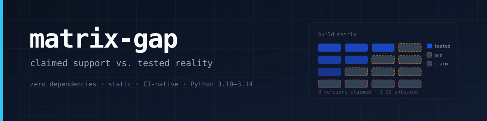
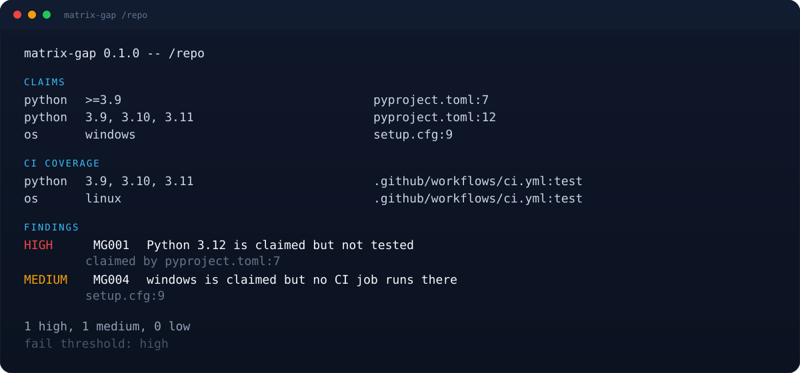

<p align="center">
  
</p>

<p align="center">
  <a href="https://github.com/muguang1224/matrix-gap/actions/workflows/ci.yml"></a>
  
  
  <a href="LICENSE"></a>
</p>

**Your README says “supports Python 3.9+”. Your CI tests 3.10, 3.11 and 3.12. The other versions are a promise nobody checked.**

`matrix-gap` reads the machine-readable support claims in a repository, expands the GitHub Actions build matrix the way GitHub does (axes, `include`, `exclude`), and reports the difference. It is a static reader: zero dependencies, no network, no edits.

<p align="center">
  
</p>

## Why

Support claims are cheap to write and expensive to verify. The usual failure modes are silent:

- `requires-python = ">=3.9"` but only 3.9–3.11 run in CI;
- classifiers advertise 3.12 while `requires-python` excludes it;
- `Operating System :: Microsoft :: Windows` with an Ubuntu-only matrix;
- an MSRV of 1.70 that is never built;
- a version tested below the Go directive’s minimum;
- `3.10` written without quotes in YAML, which YAML reads as the float `3.1`.

`matrix-gap` turns each of those into a finding with a file and line number, and a stable JSON report for CI.

## Quick start

```bash
git clone https://github.com/muguang1224/matrix-gap
cd matrix-gap
python3 matrix_gap.py /path/to/repo
```

Example:

```text
matrix-gap 0.1.0 -- /path/to/repo

CLAIMS
  python  >=3.9                          pyproject.toml:7
  python  3.9, 3.10, 3.11                pyproject.toml:12
  os      windows                        setup.cfg:9

CI COVERAGE
  python  3.9, 3.10, 3.11                .github/workflows/ci.yml:test
  os      linux                          .github/workflows/ci.yml:test

FINDINGS
  HIGH   MG001  Python 3.12 is claimed but not tested
         claimed by pyproject.toml:7
  MEDIUM MG004  windows is claimed but no CI job runs there
         setup.cfg:9

1 high, 1 medium, 0 low
```

JSON mode is meant for CI and agents. It always contains every finding;
`--min-severity` only filters the human report:

```bash
python3 matrix_gap.py . --json
python3 matrix_gap.py . --min-severity high --fail-on high
```

Exit codes: `0` no finding at or above `--fail-on`, `1` such a finding exists, `2` tool error. `--min-severity` only filters the human report; `--fail-on` decides the exit code, so the two can be set independently.

## Rules

| Code | Severity | What it means |
|------|----------|---------------|
| MG001 | high | A claimed runtime version is not tested |
| MG002 | high | A Python classifier contradicts `requires-python` |
| MG003 | medium | CI tests a version outside the claimed range |
| MG004 | medium | An operating system is claimed but no job runs there |
| MG005 | low | A dynamic matrix or value could not be expanded |
| MG006 | low | An unquoted version such as `3.10` may be read as a float |
| MG007 | low | Duplicate values in a matrix axis |
| MG008 | medium | An end-of-life version is still advertised (with `--eol`) |
| MG009 | high | A version/OS is claimed but no concrete CI coverage exists |
| MG010 | low | The matrix exceeded `--max-combos`; coverage was approximated |
| MG011 | high | A Rust MSRV is declared but not tested |

## What it reads

| File | Claim |
|------|-------|
| `pyproject.toml` | `[project].requires-python`, classifiers; Poetry `python` / classifiers |
| `setup.cfg` | `python_requires`, classifiers |
| `setup.py` | `python_requires` |
| `package.json` | `engines.node` |
| `Cargo.toml` | `package.rust-version`, `[workspace.package].rust-version` |
| `go.mod` | `go` directive |
| `tox.ini` | `envlist` (including `py{39,310}` and `3{9-12}`) |
| `.github/workflows/*.yml` | matrix axes, `include`/`exclude`, `setup-*` versions, `runs-on`, action refs such as `dtolnay/rust-toolchain@1.70.0` |

## Boundaries

This is an auditor, not a YAML implementation.

- **Dynamic means unknown.** `${{ fromJSON(...) }}`, `3.x`, `lts/*`, `stable`, `self-hosted`, `*-version-file` produce MG005; the tool does not invent coverage and does not fail the build for gaps it cannot see.
- **Node gaps consider LTS majors.** Odd Node majors are short-lived; they are not reported as missing unless the claim itself excludes the tested line.
- **Version snapshot.** The candidate set ends at Python 3.15 / Node 26 (October 2026). Newer releases are not assumed.
- **Include/exclude is approximated.** Coverage is computed from expanded combinations; exact GitHub job cardinality is not modeled when an `include` entry conflicts.
- **Read-only.** It never edits files, never calls the network, and never installs anything.

## Tests

```bash
python3 -m unittest discover -s tests -v
```

134 tests cover the TOML subset, PEP 440 and Node ranges, matrix expansion, block scalars, CRLF/BOM, dynamic values, exit codes, and the end-to-end findings. The repository dogfoods itself in CI.

## Layout

```
matrix_gap.py            single-file CLI
tests/                   unittest suite
.github/workflows/ci.yml test matrix + self-audit
assets/                  banner and demo
SKILL.md                 agent skill wrapper
```

## 中文简介

`matrix-gap` 是一个零依赖的静态审计工具：把仓库里“声称支持”的 Python / Node / Go / Rust 版本和操作系统，与 GitHub Actions 矩阵“实际测试”的内容对齐，报告两者之间的缺口。它展开矩阵的 `include` / `exclude`，识别动态矩阵并明确标记为未知，不会猜测；只读文件，不联网，不改代码。适合放进 CI：`--fail-on high` 让“声称支持但从未测试”的版本直接失败。

## License

MIT
